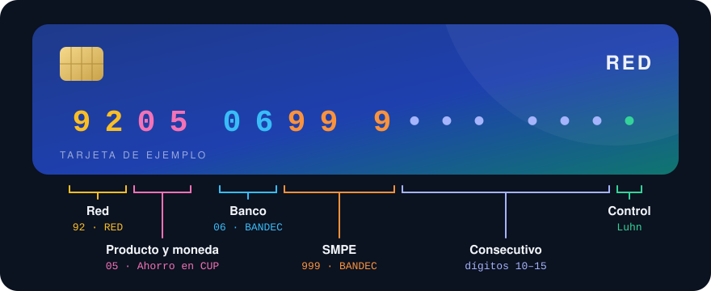
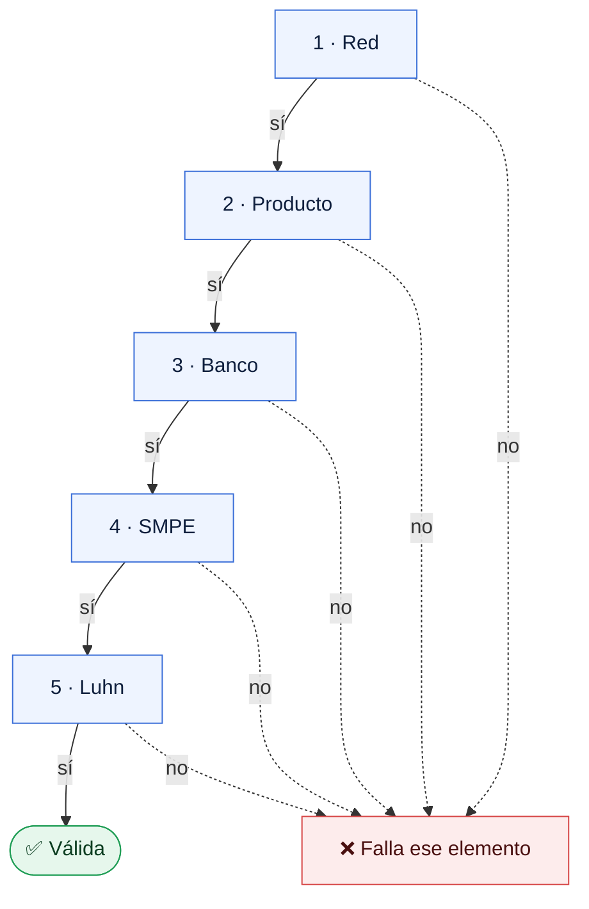

<div align="center">



# Prefijos de tarjetas cubanas

**Qué producto, qué moneda y qué banco hay detrás de cada tarjeta cubana.**<br>
Un catálogo abierto, con sus fuentes, y validadores listos para usar en cualquier lenguaje.

<!-- badges:start -->
    [](LICENSE) [](https://github.com/qvapay/cuban_cards_prefixes/actions/workflows/check.yml)
<!-- badges:end -->

[Inicio rápido](#-inicio-rápido) · [Anatomía](#-anatomía-de-una-tarjeta) · [Prefijos](#-prefijos) · [Validar](#-validar-un-número) · [Formato](#-formato-de-los-datos) · [Versiones](#-versiones-y-compatibilidad) · [Contribuir](#-contribuir) · [English](#-english)

</div>

---

## ✨ Para qué sirve

- **Validar formularios.** Rechaza al momento un número que no es una tarjeta cubana o que tiene un dígito mal tecleado.
- **Decir qué tarjeta es mientras se escribe.** Con los 9 primeros dígitos ya puedes mostrar «Tarjeta en CUP · BANDEC · Ahorro».
- **Evitar envíos a la tarjeta equivocada.** Distingue CUP, USD con respaldo en MLC y la Clásica antes de mandar el dinero.
- **Sin dependencias, en cualquier lenguaje.** Son dos ficheros JSON y unas expresiones regulares.
- **Con fuentes.** Cada prefijo dice de dónde sale, y lo que no está confirmado se marca como tal.

> [!NOTE]
> No es una fuente oficial de ningún banco. Es un catálogo comunitario: verifica los datos antes de usarlos para mover dinero.

## ⚡ Inicio rápido

Los datos se pueden usar directamente desde la CDN de jsDelivr, que admite CORS y sirve también en el navegador, o desde GitHub:

```text
https://cdn.jsdelivr.net/gh/qvapay/cuban_cards_prefixes@main/validators.json
https://cdn.jsdelivr.net/gh/qvapay/cuban_cards_prefixes@main/prefixes.json
https://raw.githubusercontent.com/qvapay/cuban_cards_prefixes/main/prefixes.json
```

```js
const v = await fetch('https://cdn.jsdelivr.net/gh/qvapay/cuban_cards_prefixes@main/validators.json').then(r => r.json())

const n = '9205 0699 9000 0001'.replace(new RegExp(v.normalize.strip_pattern, 'g'), '')

new RegExp(v.patterns.cup).test(n)     // true: es una tarjeta en CUP
new RegExp(v.issuers.BANDEC).test(n)   // true: es de BANDEC
// Falta el dígito de control: ver «Validar un número»
```

`@main` siempre trae la última versión. Para que tu integración no cambie sin que lo decidas tú, fija una versión: `@v0.8.1` en lugar de `@main`. Ver [Versiones y compatibilidad](#-versiones-y-compatibilidad).

Cada push a `main` purga la caché de jsDelivr, así que `@main` refleja el cambio en pocos minutos en lugar de las 12 horas que tarda por defecto.

| Fichero | Qué contiene |
|---|---|
| [`prefixes.json`](prefixes.json) | El catálogo: estructura del número, bancos, prefijos con su producto y su moneda, y fuentes. Es el único fichero que se edita a mano. |
| [`validators.json`](validators.json) | Expresiones regulares generadas a partir del catálogo: por moneda, por banco y para la Clásica y sus variantes. |
| [`schema.json`](schema.json) | El esquema de `prefixes.json` (JSON Schema 2020-12). |
| [`CHANGELOG.md`](CHANGELOG.md) | Qué cambió en cada versión y si afecta a lo que aceptan los patrones. |

## 🔢 Anatomía de una tarjeta

Las tarjetas cubanas tienen 16 dígitos, repartidos en seis elementos:

| Dígitos | Elemento | Ejemplo |
|:-:|---|---|
| 1–2 | **Red** | `92` |
| 3–4 | **Producto** | `05` |
| 5–6 | **Banco** | `06` |
| 7–9 | **SMPE** | `999` |
| 10–15 | Consecutivo | |
| 16 | Dígito de control [Luhn](https://es.wikipedia.org/wiki/Algoritmo_de_Luhn) (ISO/IEC 7812) | |

Cada elemento depende del anterior: el producto y el banco dependen de la red, y el SMPE depende del banco.

### Red

La red a la que pertenece la tarjeta. Su código siempre empieza por 9.

| Red | Código | Productos | Bancos |
|---|:-:|---|---|
| **RED** | `92` | Los de [Prefijos](#-prefijos): CUP, USD con respaldo en MLC y la Tropical en USD | BANDEC, BPA, Metropolitano, BICSA |
| **AIS** | `95` | `50` CUP, `60` USD | AIS |
| **Clásica** | `97` | `60` USD | FINCIMEX |

### Producto

Qué tarjeta es y en qué moneda. **Un mismo código puede significar cosas distintas en cada red**: `50` es USD con respaldo en MLC en RED, pero CUP en AIS. Por eso el producto siempre se lee junto con la red, y la combinación de los dos es el **prefijo** (`9205`, `9550`…) que cataloga este repositorio.

### Banco

El banco o la entidad que emite la tarjeta. Cada banco pertenece a una sola red. Un producto suele existir en todos los bancos de su red; la excepción es la Tropical (`9240`), que solo emite BANDEC.

### SMPE

Sistema de Medios de Pago Electrónicos: Sufijo de la red interbancaria. **No forma parte del código del banco**, pero cada banco tiene siempre el mismo, así que sirve para confirmarlo: un número de BANDEC sigue siempre con `999`. Los códigos y los SMPE de cada banco están en la tabla de [Bancos](#-bancos).

## 🏦 Bancos

<!-- banks:start -->
| Banco | Red | Código | SMPE | Patrón |
|---|:-:|:-:|:-:|---|
| **BANDEC** · Banco de Crédito y Comercio | RED `92` | `06` | `999` | `issuers.BANDEC` |
| **BPA** · Banco Popular de Ahorro | RED `92` | `12` | `997` | `issuers.BPA` |
| **Banco Metropolitano** | RED `92` | `95` | `987` | `issuers.METROPOLITANO` |
| **BICSA** · Banco Internacional de Comercio S.A. | RED `92` | `04` | — | `issuers.BICSA` |
| **FINCIMEX** · Financiera CIMEX S.A. | Clásica `97` | `03` | `900` | `issuers.FINCIMEX` |
| **AIS** · American International Services | AIS `95` | `02` | `90·` (parcial) | `issuers.AIS` |
<!-- banks:end -->

## 📋 Prefijos

<!-- prefixes:start -->
### 🇨🇺 Pesos cubanos (CUP)

| Prefijo | Producto | Confirmado en | Fuentes |
|:-:|---|---|:-:|
| **`9200`** | Ahorro ¹ | BANDEC, Metropolitano | C · H · T · O |
| **`9202`** | Estímulo | — | C · O |
| **`9204`** | Nómina, fondos, ahorro ² | BANDEC, BPA | B · H · C · T · O · BD · BP |
| **`9205`** | Ahorro ³ | BANDEC, Metropolitano, BPA | B · H · C · T · O · BD · BP |
| **`9206`** | Jubilación | BANDEC, BPA | B · H · C · O · BD · BP |
| **`9210`** | Colaboradores | BANDEC | B · H · C · T · BD |
| **`9211`** | Colaboradores | BANDEC | B · H · C · T · BD |
| **`9212`** | Trabajadores por cuenta propia (TCP) 🧾 ⁴ | BANDEC, Metropolitano | B · H · C · T · O · BD |
| **`9213`** | Trabajadores por cuenta propia (TCP) 🧾 ⁵ | BANDEC | B · H · C · O · BD |
| **`9216`** | Subsidios | BANDEC | B · H · C · BD |
| **`9224`** | Nómina, fondos, ahorro ⁶ | BANDEC, Metropolitano | B · H · C · T · O · BD |
| **`9227`** | Nómina, fondos, ahorro ⁷ | BANDEC, Metropolitano | B · H · C · T · O · BD |
| **`9233`** | MIPYMES / cooperativas no agropecuarias | BANDEC, BPA | B · H · C · BD · BP |
| **`9234`** | Nómina | BANDEC, Metropolitano | C · T |
| **`9236`** | Cuentas corrientes y créditos ⁸ | BPA | T |
| **`9237`** | Agricultores / usufructuarios ⁹ | BANDEC, BPA | B · H · C · BD · BP |
| **`9238`** | Ahorro | BPA | C · T · BP |
| **`9244`** | Nómina, fondos, ahorro (10) | BANDEC | C · BD |
| **`9248`** | _Sin identificar_ · [¿la tienes?](https://github.com/qvapay/cuban_cards_prefixes/issues/new?template=prefijo.yml&prefix=9248) | — | C |
| **`9550`** | AIS CUP (11) | AIS | A · FX |

> ¹ **`9200`**: El catálogo comunitario y la nota de BANDEC la describen como «Tarjeta en CUP», sin propósito concreto. Titulares la confirman en BANDEC (issue #9) y en Banco Metropolitano (issue #14). Un titular reporta que son las antiguas tarjetas en CUC, que pasaron a CUP al retirarse esa moneda (issue #14); falta otra fuente que lo confirme. La ONAT le da dos usos: ahorro en CUP y ahorro en USD.
>
> ² **`9204`**: BPA confirmado por un titular con su tarjeta (9204 1299), reportada directamente al mantenedor el 2026-10-21. La ONAT la describe como nómina.
>
> ³ **`9205`**: Banco Metropolitano y BPA confirmados por titulares (issues #18 y #12).
>
> ⁴ **`9212`**: Banco Metropolitano confirmado por un titular, reportado directamente al mantenedor el 2026-10-21. Cuenta bancaria fiscal (CBF) en CUP; la ONAT detalla sus usos: TCP, taxistas, GNE y APE.
>
> ⁵ **`9213`**: Cuenta bancaria fiscal (CBF) en CUP; la ONAT detalla sus usos: TCP, taxistas, GNE y APE.
>
> ⁶ **`9224`**: Banco Metropolitano confirmado por un titular en el issue #10. Según la ONAT, es una extensión del producto 04 (nómina).
>
> ⁷ **`9227`**: Banco Metropolitano confirmado por un titular en el issue #8. Tiene dos usos: nómina, como extensión del producto 24, y nómina de artistas, que según la ONAT es una cuenta bancaria fiscal (CBF). Como solo uno de sus usos es fiscal, no lleva el campo fiscal.
>
> ⁸ **`9236`**: Cuentas corrientes y asociadas a créditos y consumos específicos en pesos. Típica de líneas de crédito y subsidios estatales a personas naturales.
>
> ⁹ **`9237`**: El BPA la llama «Trabajadores por cuenta propia»; BANDEC, «Agricultores / usufructuarios». Los propósitos pueden diferir según el banco.
>
> (10) **`9244`**: BANDEC la agrupa con nómina, formación de fondos y ahorro.
>
> (11) **`9550`**: Cuando se emitió era en CUC. Con la eliminación del CUC pasó a CUP, según el aviso de FINCIMEX.

### 💵 USD con respaldo en MLC

| Prefijo | Producto | Confirmado en | Fuentes |
|:-:|---|---|:-:|
| **`9225`** | Ahorro de personas naturales | BANDEC, BPA | B · H · C · O · BD · BP |
| **`9226`** | TCP / productores agropecuarios 🧾 ¹ | BANDEC, BPA | B · H · C · O · BD · BP |
| **`9228`** | Cooperativas / MIPYMES | BANDEC, BPA | B · H · C · BD · BP |
| **`9229`** | Otras entidades ² | BANDEC | B · H · C · BD |
| **`9235`** | Ahorro de personas naturales ³ | BANDEC, BPA | B · H · C · O · BD · BP |
| **`9245`** | _Sin identificar_ · [¿la tienes?](https://github.com/qvapay/cuban_cards_prefixes/issues/new?template=prefijo.yml&prefix=9245) | — | C |
| **`9250`** | Cooperativas / MIPYMES ⁴ | BANDEC | C · H |

> ¹ **`9226`**: Cuenta bancaria fiscal (CBF) en USD con respaldo en MLC; la ONAT detalla sus usos: TCP, OFGNE y APE.
>
> ² **`9229`**: El catálogo comunitario la describe como «Personas jurídicas».
>
> ³ **`9235`**: Según la ONAT, es una extensión del producto 25.
>
> ⁴ **`9250`**: La nota de BANDEC que reproduce el portal de La Habana la agrupa con la 9228.

### 💳 USD

| Prefijo | Producto | Confirmado en | Fuentes |
|:-:|---|---|:-:|
| **`9240`** | Prepago en USD · «Tropical» ¹ | BANDEC | B · H · C · D · BD |
| **`9760`** | Clásica · `976004` Clásica Empresarial ² | FINCIMEX | C · T · CE |
| **`9560`** | AIS USD | AIS | A |

> ¹ **`9240`**: Prepago en USD sin respaldo en MLC. Directorio Cubano (2025) la describe como la tarjeta prepago en dólares de BANDEC, antes conocida como «9240», y la distingue de la 9225 y la 9235, conocidas como tarjetas en MLC. BANDEC la agrupa con las tarjetas en USD con respaldo en MLC y, en la nota que reproduce el portal de La Habana, la llama «Tropical». El catálogo comunitario también la llama «Tropical» y la clasifica como prepago en USD. Solo se conoce en BANDEC. BANDEC la publica como «Tarjeta Tropical» para personas naturales y actores económicos no estatales.
>
> ² **`9760`**: Es de la red Clásica (`97`). Los dígitos 5–6 distinguen 976003 (Clásica, reportada en el issue #5 y en el PR #6) de 976004 (Clásica Empresarial).
<!-- prefixes:end -->

🧾 marca las cuentas bancarias fiscales (CBF) según la ONAT. **Confirmado en** son los bancos en los que una fuente confirma ese producto. No es una lista cerrada: el mismo producto puede existir en otros bancos, y los validadores lo aceptan en cualquier banco conocido. Las letras de **Fuentes** se explican en [Fuentes](#-fuentes).

## ✅ Validar un número

Se valida un elemento cada vez, en orden, y cada uno contra los anteriores. El primero que falla es el que hay que corregir, y se puede avisar mientras el usuario escribe.



| | Elemento | Es válido si… | Ejemplo que falla | Por qué |
|:-:|---|---|---|---|
| 1 | Red | es `92`, `95` o `97` | `93 …` | No es una red |
| 2 | Producto | existe en esa red | `95 05 …` | `05` es un producto de RED, no de AIS |
| 3 | Banco | es de esa red y, si el producto es exclusivo, de sus bancos | `92 05 03 …`<br>`92 40 12 …` | `03` es de la Clásica<br>La Tropical solo es de BANDEC |
| 4 | SMPE | es el de ese banco | `92 05 06 987 …` | `987` es el de Metropolitano |
| 5 | Luhn | el dígito de control cuadra | un dígito mal tecleado | |

Para validar un número completo:

1. **Normaliza** el número: quita lo que indica `normalize.strip_pattern`.
2. **Compara** con un patrón de `validators.json`. Los patrones hacen los pasos 1 a 4 de una vez; para saber cuál falla, usa `validators.networks` (ver `explain` en el ejemplo de JavaScript).
3. **Comprueba el dígito de control** Luhn. Una expresión regular no puede hacerlo, pero son pocas líneas de código.

| Patrón | Acepta |
|---|---|
| `patterns.any` | Cualquier tarjeta cubana del catálogo |
| `patterns.red` | Cualquier tarjeta de la red RED |
| `patterns.cup` | Tarjetas en CUP |
| `patterns.usd` | Tarjetas en USD: con respaldo en MLC, Tropical, Clásica y AIS USD |
| `patterns.usd_mlc` | Tarjetas en USD con respaldo en MLC |
| `patterns.clasica` | Tarjeta Clásica, incluida la Clásica Empresarial |
| `patterns.clasica_empresarial` | Clásica Empresarial (`976004`) |
| `patterns.ais_cup`, `patterns.ais_usd` | Tarjetas AIS en CUP y en USD |
| `issuers.<BANCO>` | Tarjetas de ese banco o emisora |

Los patrones usan `[0-9]` en lugar de `\d`, porque en Python y en otros motores `\d` también acepta dígitos que no son ASCII. Funcionan igual en JavaScript, Python, PHP, Java, Go, Dart y Ruby.

<details open>
<summary><b>JavaScript</b></summary>

Pasa el número como cadena: un `Number` de 16 dígitos pierde precisión. `kind` debe ser una cadena con una clave de `v.patterns`, en minúsculas. Un tipo desconocido lanza `RangeError` con la lista de valores admitidos.

```js
const BASE = 'https://cdn.jsdelivr.net/gh/qvapay/cuban_cards_prefixes@main'
const [catalog, v] = await Promise.all(
  ['prefixes.json', 'validators.json'].map(f => fetch(`${BASE}/${f}`).then(r => r.json()))
)

const luhn = (n) => {
  let sum = 0
  for (let i = 0; i < n.length; i++) {
    let d = Number(n[n.length - 1 - i])
    if (i % 2) { d *= 2; if (d > 9) d -= 9 }
    sum += d
  }
  return sum % 10 === 0
}

const normalize = (raw) => String(raw ?? '').replace(new RegExp(v.normalize.strip_pattern, 'g'), '')

// kind: any | red | cup | usd | usd_mlc | clasica | clasica_empresarial | ais_cup | ais_usd
const isCubanCard = (raw, kind = 'any') => {
  if (typeof kind !== 'string' || !Object.hasOwn(v.patterns, kind)) {
    throw new RangeError(`kind inválido: ${String(kind)}. Usa: ${Object.keys(v.patterns).join(', ')}`)
  }
  const n = normalize(raw)
  return new RegExp(v.patterns[kind]).test(n) && luhn(n)
}

// { prefix, currency, mlc_backed, product, bank } o null
const describe = (raw) => {
  const n = normalize(raw)
  if (!isCubanCard(n)) return null
  const p = catalog.prefixes.find(p => p.prefix === n.slice(0, 4))
  const bank = Object.keys(v.issuers).find(id => new RegExp(v.issuers[id]).test(n)) ?? p.issuers[0] ?? null
  const product = v.variants?.[n.slice(0, 6)]?.product ?? p.product
  return { prefix: p.prefix, currency: p.currency, mlc_backed: p.mlc_backed, product, bank }
}

describe('9205 0699 9000 0001')
// { prefix: '9205', currency: 'CUP', mlc_backed: false, product: 'Ahorro', bank: 'BANDEC' }

// Primer elemento que falla con lo que se lleva escrito, o null. Sirve mientras se escribe.
const explain = (raw) => {
  const n = normalize(raw)
  const net = v.networks[n.slice(0, 2)]
  if (n.length >= 2 && !net) return 'red'
  const product = net?.products[n.slice(2, 4)]
  if (n.length >= 4 && !product) return 'producto'
  const bank = n.slice(4, 6)
  if (n.length >= 6 && !product.issuers.includes(bank)) return 'banco'
  const smpe = net?.issuers[bank]?.smpe ?? ''
  if (n.length > 6 && !smpe.startsWith(n.slice(6, 6 + smpe.length))) return 'smpe'
  if (n.length === 16 && !luhn(n)) return 'luhn'
  return null
}

explain('9205 06')    // null
explain('9205 0698')  // 'smpe'
```

</details>

<details>
<summary><b>Python</b></summary>

```python
import json, re, urllib.request

BASE = 'https://cdn.jsdelivr.net/gh/qvapay/cuban_cards_prefixes@main'

def load(name):
    with urllib.request.urlopen(f'{BASE}/{name}') as r:
        return json.load(r)

catalog, v = load('prefixes.json'), load('validators.json')

def luhn(n):
    total = 0
    for i, ch in enumerate(reversed(n)):
        d = int(ch)
        if i % 2:
            d = d * 2 - 9 if d > 4 else d * 2
        total += d
    return total % 10 == 0

def normalize(raw):
    return re.sub(v['normalize']['strip_pattern'], '', str(raw or ''))

def is_cuban_card(raw, kind='any'):
    n = normalize(raw)
    return re.match(v['patterns'][kind], n) is not None and luhn(n)

def describe(raw):
    n = normalize(raw)
    if not is_cuban_card(n):
        return None
    p = next(p for p in catalog['prefixes'] if p['prefix'] == n[:4])
    bank = next((bank for bank, pattern in v['issuers'].items() if re.match(pattern, n)), None)
    variant = v.get('variants', {}).get(n[:6], {})
    return {
        'prefix': p['prefix'],
        'currency': p['currency'],
        'mlc_backed': p['mlc_backed'],
        'product': variant.get('product', p['product']),
        'bank': bank or next(iter(p['issuers']), None),
    }

describe('9205 0699 9000 0001')
# {'prefix': '9205', 'currency': 'CUP', 'mlc_backed': False, 'product': 'Ahorro', 'bank': 'BANDEC'}
```

</details>

<details>
<summary><b>PHP</b></summary>

Un `$kind` desconocido lanza `InvalidArgumentException` con la lista de valores admitidos.

```php
<?php
$base = 'https://cdn.jsdelivr.net/gh/qvapay/cuban_cards_prefixes@main';
$v = json_decode(file_get_contents("$base/validators.json"), true);

function luhn(string $n): bool {
    $sum = 0;
    foreach (array_reverse(str_split($n)) as $i => $ch) {
        $d = (int) $ch;
        if ($i % 2) { $d *= 2; if ($d > 9) $d -= 9; }
        $sum += $d;
    }
    return $sum % 10 === 0;
}

function normalizeCard(string $raw, array $v): string {
    return preg_replace('/' . $v['normalize']['strip_pattern'] . '/', '', $raw);
}

// $kind: any | red | cup | usd | usd_mlc | clasica | clasica_empresarial | ais_cup | ais_usd
function isCubanCard(string $raw, array $v, string $kind = 'any'): bool {
    if (!array_key_exists($kind, $v['patterns'])) {
        throw new InvalidArgumentException('kind inválido: ' . $kind . '. Usa: ' . implode(', ', array_keys($v['patterns'])));
    }
    $n = normalizeCard($raw, $v);
    return preg_match('/' . $v['patterns'][$kind] . '/', $n) === 1 && luhn($n);
}

// 'BANDEC' | 'BPA' | 'METROPOLITANO' | 'BICSA' | null
function bankOf(string $raw, array $v): ?string {
    $n = normalizeCard($raw, $v);
    if (!isCubanCard($n, $v, 'red')) return null;
    foreach ($v['issuers'] as $id => $pattern) {
        if (preg_match('/' . $pattern . '/', $n) === 1) return $id;
    }
    return null;
}

var_dump(isCubanCard('9205 0699 9000 0001', $v, 'cup')); // bool(true)
var_dump(bankOf('9205-0699-9000-0001', $v));             // string(6) "BANDEC"
```

</details>

## 📦 Formato de los datos

Cada prefijo de `prefixes.json` tiene esta forma:

```json
{
  "prefix": "9240",
  "network": "RED",
  "currency": "USD",
  "mlc_backed": false,
  "product": "Ahorro de personas naturales",
  "aliases": ["Tropical"],
  "issuers": ["BANDEC"],
  "exclusive": true,
  "sources": ["bandec_post", "community_catalog", "smpe_report"],
  "notes": "Es USD, no MLC (confirmado por titulares), aunque BANDEC la agrupa con las tarjetas en USD con respaldo en MLC. El catálogo comunitario la llama «Tropical». Solo existe en BANDEC."
}
```

| Campo | Qué es |
|---|---|
| `prefix` | Red y producto |
| `network` | Red de la tarjeta: `RED` (`92`), `AIS` (`95`) o `CLASICA` (`97`) |
| `currency` | `CUP` o `USD` |
| `mlc_backed` | `true` si es USD con respaldo en MLC, como lo llama BANDEC. `null` si no se sabe |
| `product` | Producto o propósito. `null` si todavía no se ha identificado |
| `aliases` | Otros nombres con los que se conoce |
| `issuers` | Bancos en los que una fuente confirma el producto |
| `sources` | Fuentes de ese dato (lista `sources` al final del fichero) |
| `notes` | Aclaraciones: productos con más de un uso y diferencias entre fuentes |
| `exclusive` | Opcional. `true` si el producto solo existe en los bancos de `issuers` (la Tropical) |
| `variants` | Opcional, solo en productos que no son RED. Prefijos de 6 dígitos con otro producto (la Clásica Empresarial, `976004`) |
| `fiscal` | Opcional. `true` si la ONAT lo lista como cuenta bancaria fiscal (CBF) |

En `issuers`, `code` es el código del banco y `smpe` su SMPE. Si `smpe` está incompleto, el resto todavía no se conoce; si es `null`, no se conoce.

`validators.networks` tiene lo mismo separado por elemento: por cada red, sus productos (moneda y bancos en los que existen) y sus bancos (con su SMPE).

## 🔖 Versiones y compatibilidad

Hay apps que leen estos ficheros directamente desde `@main`, así que cuidamos qué cambia de una versión a otra. La versión está en `prefixes.json` y en `validators.json`, y cada cambio se anota en el [registro de cambios](CHANGELOG.md).

| Cambio | ¿Afecta a tu integración? |
|---|---|
| Prefijos, bancos, fuentes o campos opcionales nuevos, o un `product` que deja de ser `null` | No |
| Claves nuevas en `validators.json` | No |
| Una corrección de datos que cambia lo que aceptan los patrones | Puede: un número que antes pasaba deja de pasar, o al revés. Se anota en el registro de cambios. Por ejemplo, en la 0.2.0 Banco Metropolitano pasó de `95··` a `9598`. |
| Cambiar el formato o el significado de un campo, o renombrar o quitar una clave | Sí. Se avisa con una versión mayor, como en la 0.8.0. |

> [!IMPORTANT]
> **Este fork sigue su propio modelo desde la 0.8.0** y ya no es compatible con el repositorio original: `issuers[].code` tiene 2 dígitos (dígitos 5–6) y el SMPE va aparte en `smpe`, `network` es `RED`, `AIS` o `CLASICA`, los patrones exigen el SMPE de cada banco y `validators.json` añade `networks`. Si necesitas el formato original, usa [qvapay/cuban_cards_prefixes](https://github.com/qvapay/cuban_cards_prefixes).

Para que nada cambie sin que lo decidas tú, fija una versión en la URL:

```text
https://cdn.jsdelivr.net/gh/qvapay/cuban_cards_prefixes@v0.8.1/validators.json
```

## 📚 Fuentes

<!-- sources:start -->
| | Fuente | Qué aporta |
|:-:|---|---|
| **B** | ¿Sabías que los dígitos de tu tarjeta Bandec revelan su propósito? | Publicación atribuida a BANDEC sobre los dígitos 3–4 de sus tarjetas. El portal del Gobierno de La Habana la reproduce (fuente H). |
| **H** | [Cómo identificar tarjetas bancarias en Cuba por sus dígitos](https://www.lahabana.gob.cu/post_detalles/es/29956/como-identificar-tarjetas-bancarias-en-cuba-por-sus-digitos) | Portal del Ciudadano de La Habana (7 de agosto de 2026). Reproduce la nota de BANDEC con los mismos prefijos en CUP y en USD, incluye la 9250 junto a la 9228 y llama «Tropical» a la 9240. Aportado en el issue #11. |
| **C** | Cuban Bank Card Prefixes v1.0.0 (2026-06-20) | Catálogo comunitario. Para la estructura del número cita el documento «Tomo 2 Digital». |
| **T** | Titulares de tarjeta | Titulares que confirman el código de banco de BANDEC (0699), BPA (1299) y Banco Metropolitano (9598); las tarjetas BANDEC 9210 y 9211; la 9200 en BANDEC y Banco Metropolitano; la 9204 de nómina en BPA; la 9205 de ahorro en BPA y Banco Metropolitano; la 9212 de TCP en Banco Metropolitano; la 9224, la 9227 y la 9234 en Banco Metropolitano; la 9238 de ahorro en BPA, y la Clásica 976003 (issues #1, #2, #4, #8, #9, #10, #12, #14 y #18; PR #6). |
| **S** | Titulares: banco y SMPE | Redes 92 (RED), 95 (AIS) y 97 (Clásica); código de banco y SMPE de cada banco (BANDEC 06·999, BPA 12·997, Metropolitano 95·987, Clásica 03·900, AIS 02·90); productos AIS 50 (CUP) y 60 (USD); la Tropical (9240) es USD sin respaldo en MLC y solo existe en BANDEC. |
| **F** | [Kubaforum: «Überweisung mit Sparkasse auf BPA-Konto»](https://www.kubaforum.eu/artikel/ueberweisung-mit-sparkasse-auf-bpa-konto.35643/) | Hilo de foro en alemán (diciembre de 2023). Da los dígitos 5–8 de BANDEC (0699), BPA (1299) y Banco Metropolitano (9598). Aportado en el issue #3. |
| **CE** | [Informa Financiera CIMEX S.A. sobre ampliación de posibilidades de uso de tarjeta Clásica Empresarial](http://www.cubadebate.cu/noticias/2025/04/04/informa-financiera-cimex-s-a-sobre-ampliacion-de-posibilidades-de-uso-de-tarjeta-clasica-empresarial/) | Confirma la existencia de la Clásica Empresarial de FINCIMEX; no publica el prefijo 976004. |
| **A** | [Cimex responde a usuarios sobre dudas con respecto a las tarjetas AIS (Directorio Cubano, 2020)](https://www.directoriocubano.info/panorama/cimex-responde-a-usuarios-sobre-dudas-con-respecto-a-las-tarjetas-ais) | Cimex confirma que las tarjetas AIS empiezan por 9550 (entonces en CUC) y 9560 (USD). Aportada en el PR #16. |
| **FX** | [FINCIMEX: «Aclaración a nuestros clientes»](https://www.facebook.com/fincimex/posts/aclaraci%C3%B3n-a-nuestros-clienteslos-clientes-de-tarjetas-ais-no-tendr%C3%A1n-que-presen/752525275358296/) | Aviso en la cuenta oficial de FINCIMEX en Facebook: las tarjetas AIS en CUC pasan a CUP. Aportada en el PR #16. |
| **D** | [¿Conoces la tarjeta Tropical en dólares de Cuba? Banco informa sobre este producto (Directorio Cubano, 2025)](https://www.directoriocubano.info/panorama/conoces-la-tarjeta-tropical-en-dolares-de-cuba-banco-informa-sobre-este-producto/) | La 9240 («Tropical») es la tarjeta prepago en dólares de BANDEC, distinta de la 9225 y la 9235, conocidas como tarjetas en MLC. Aportada en el PR #16. |
| **O** | [ONAT: cómo identificar si una tarjeta corresponde a una cuenta bancaria fiscal (CBF)](https://www.facebook.com/onat.gob.cu/posts/1069813675327751/) | Publicación en la cuenta oficial de la ONAT en Facebook. Tabla con el producto de cada prefijo y cuáles son cuentas bancarias fiscales (CBF). |
| **BD** | [BANDEC (Facebook): códigos de producto de sus tarjetas](https://www.facebook.com/permalink.php?story_fbid=pfbid02cueKUG8oBcz9r7ABGX935dryK2saEZ4QZVec6QrNxv2pzZ3qxsCuBzg9FhDaAJ5l&id=100063861381020) | Publicación en la cuenta oficial de BANDEC: productos en CUP (04, 05, 24, 27, 34 y 44 nómina, formación de fondos y ahorro; 06 jubilación; 10 y 11 colaboradores; 12 y 13 TCP; 16 subsidios; 33 MIPYMES; 37 agricultores) y en USD con respaldo en MLC (25 y 35 personas naturales; 40 Tropical; 26 TCP y productores agropecuarios; 28 cooperativas y MIPYMES; 29 otras entidades). |
| **BP** | BPA: cómo identificar los tipos de tarjeta magnética según el producto | Imagen del BPA (#Bancarización #PagosElectrónicos): ahorro en CUP 9205 o 9238, salario 9204, jubilados 9206, cuenta MLC 9225, 9235, 9226 y 9228, TCP 9237 y MIPYMES 9233. Aclara que los propósitos pueden diferir según el banco. |
| **ISO** | [ISO/IEC 7812-1: números de identificación de tarjetas](https://en.wikipedia.org/wiki/ISO/IEC_7812) | El último dígito de un número de tarjeta es un dígito de control Luhn. |
<!-- sources:end -->

## 🔍 Ayúdanos a completarlo

- El producto de los prefijos marcados como _Sin identificar_ en las tablas.
- Los dígitos 7–9 de BICSA.
- El SMPE de BICSA y el último dígito del SMPE de AIS.
- Una tarjeta Clásica Empresarial que confirme el `976004`. Hoy sale de la lógica de Transfermóvil analizada en el [#5](https://github.com/qvapay/cuban_cards_prefixes/issues/5).
- El enlace a la publicación original de BANDEC (el portal del Gobierno de La Habana la reproduce: fuente **H**).

¿Tienes una de esas tarjetas o una fuente? [Cuéntanoslo](https://github.com/qvapay/cuban_cards_prefixes/issues/new?template=prefijo.yml).

## 🙌 Quién ha aportado

Este catálogo crece con lo que comparte la comunidad. Muchos reportes llegan desde el [Explorador de tarjetas cubanas](https://rblez.github.io/explorador-tarjetas-cubanas/) de [@rblez](https://github.com/rblez), que consume este catálogo en vivo y permite reportar un prefijo con un clic. Gracias a:

| Quién | Qué aportó |
|---|---|
| [@edyermorales](https://github.com/edyermorales) | La `9234` de nómina en BANDEC y la `9238` de ahorro en BPA ([#1](https://github.com/qvapay/cuban_cards_prefixes/issues/1), [#2](https://github.com/qvapay/cuban_cards_prefixes/issues/2)). |
| [@armandofcom](https://github.com/armandofcom) | El código `9598` de Banco Metropolitano, con el hilo de Kubaforum que lo documenta ([#3](https://github.com/qvapay/cuban_cards_prefixes/issues/3)). |
| [@Y4S3L23](https://github.com/Y4S3L23) | La confirmación, con su propia tarjeta, del `9598` y de la `9234` en Banco Metropolitano ([#4](https://github.com/qvapay/cuban_cards_prefixes/issues/4)). |
| [@livegnik97](https://github.com/livegnik97) | La pista de la Clásica Empresarial (`976004`) a partir de la lógica de Transfermóvil ([#5](https://github.com/qvapay/cuban_cards_prefixes/issues/5)) y el enlace oficial a la nota de BANDEC ([#11](https://github.com/qvapay/cuban_cards_prefixes/issues/11)). |
| [@drlorente97](https://github.com/drlorente97) | El `976003` de la Clásica ([#6](https://github.com/qvapay/cuban_cards_prefixes/pull/6)), las tarjetas AIS (`9550` y `9560`) con el aviso de FINCIMEX sobre su paso a CUP, la Tropical (`9240`) como prepago en USD, la `9236` en CUP, los dígitos 7–9 (SMPE) de cada banco y la tabla de la ONAT con las cuentas fiscales ([#16](https://github.com/qvapay/cuban_cards_prefixes/pull/16)). |
| [@Chichimokers](https://github.com/Chichimokers) | Las variantes por los dígitos 5–6 y la Clásica Empresarial (`976004`), con el aviso de CIMEX que la documenta ([#7](https://github.com/qvapay/cuban_cards_prefixes/pull/7)), y la `9227` en Banco Metropolitano ([#8](https://github.com/qvapay/cuban_cards_prefixes/issues/8)). |
| [@xero-q](https://github.com/xero-q) | La `9205` de ahorro en Banco Metropolitano, confirmada con su tarjeta ([#18](https://github.com/qvapay/cuban_cards_prefixes/issues/18)). |
| [@rblez](https://github.com/rblez) | El [Explorador de tarjetas cubanas](https://rblez.github.io/explorador-tarjetas-cubanas/), desde el que llegan muchos reportes, y la `9200` en BANDEC ([#9](https://github.com/qvapay/cuban_cards_prefixes/issues/9)). |
| [@vcarv7](https://github.com/vcarv7) | La `9224` en Banco Metropolitano, confirmada con su tarjeta ([#10](https://github.com/qvapay/cuban_cards_prefixes/issues/10)). |
| [@ecejas](https://github.com/ecejas) | El arreglo de los ejemplos JavaScript y PHP del README, que aceptaban cualquier número con un `kind` desconocido, y las pruebas que ahora los ejecutan en CI ([#21](https://github.com/qvapay/cuban_cards_prefixes/pull/21)). |
| [@aalvarezcbr](https://github.com/aalvarezcbr) | La `9205` de ahorro en BPA, confirmada con su tarjeta ([#12](https://github.com/qvapay/cuban_cards_prefixes/issues/12)). |
| [@earlyhp-qvapay](https://github.com/earlyhp-qvapay) | La `9200` en Banco Metropolitano y la pista de que son las antiguas tarjetas en CUC ([#14](https://github.com/qvapay/cuban_cards_prefixes/issues/14)). |

¿Tienes una tarjeta que falta o una fuente? [Cuéntanoslo](https://github.com/qvapay/cuban_cards_prefixes/issues/new?template=prefijo.yml) y apareces aquí.

## 🤝 Contribuir

- **Con un issue**: el formulario de [nuevo prefijo o corrección](https://github.com/qvapay/cuban_cards_prefixes/issues/new?template=prefijo.yml) pide los 9 primeros dígitos, el banco, la moneda, el producto y la fuente.
- **Con un pull request**:
  1. Parte de la última versión de `main` y trata un solo tema por pull request: así se revisa y se integra antes.
  2. Edita `prefixes.json` y cita la fuente de cada dato: un enlace al documento original, un documento o tu propia tarjeta. Tiene que ser algo que otra persona pueda comprobar.
  3. No cambies el formato ni el significado de los campos que ya existen, ni renombres claves de `validators.json`: hay apps que dependen de ellos. Si hace falta algo nuevo, añádelo como campo opcional. Ver [Versiones y compatibilidad](#-versiones-y-compatibilidad).
  4. Ejecuta `npm run build`. Regenera `validators.json` y las tablas de este README.
  5. Ejecuta `npm run check`. Comprueba que el catálogo es coherente y que lo generado está al día. Lo mismo corre en cada pull request.

Cuando integramos tu aporte, apareces en [Quién ha aportado](#-quién-ha-aportado).

> [!WARNING]
> **Nunca publiques un número de tarjeta completo** en un issue, un pull request o un commit. Para identificar un producto bastan los 9 primeros dígitos.

## 🇺🇸 English

<details>
<summary>Summary in English</summary>

An open catalog of **Cuban bank card prefixes**: which product, currency and bank sit behind the first digits of a Cuban card, plus ready-to-use validators for any language.

- [`prefixes.json`](prefixes.json): the catalog (card structure, banks, prefixes and sources). Texts are in Spanish.
- [`validators.json`](validators.json): regular expressions generated from the catalog, by currency (`cup`, `usd`, `usd_mlc`, `clasica`, `clasica_empresarial`, `ais_cup`, `ais_usd`, `any`) and by bank (`BANDEC`, `BPA`, `METROPOLITANO`, `BICSA`), plus a `variants` map for 6-digit prefixes such as `976004` (Clásica Empresarial).
- [`schema.json`](schema.json): JSON Schema 2020-12 for `prefixes.json`.

Cuban cards have 16 digits: 1–2 the network (`92` RED, `95` AIS, `97` Clásica), 3–4 the product and currency, 5–6 the bank (`06` BANDEC, `12` BPA, `95` Banco Metropolitano), 7–9 the SMPE (fixed per bank: `999`, `997`, `987`), 10–15 the account and 16 a Luhn check digit. From 0.8.0 this fork's patterns require the bank's SMPE and `validators.networks` lets you check each element separately.

To validate a number: strip spaces, hyphens and dots (`normalize.strip_pattern`), match it against a pattern and check the Luhn digit. See the code samples above.

To avoid unannounced changes, pin a version with `@v0.8.1` instead of `@main`. Every change is listed in [CHANGELOG.md](CHANGELOG.md).

This is a community catalog, not an official source. Never post a full card number in an issue or pull request: the first 8 digits are enough.

</details>

---

<div align="center">
<sub>Hecho con 💙 por la comunidad · Mantenido por <a href="https://qvapay.com">QvaPay</a> · <a href="LICENSE">Licencia MIT</a></sub>
</div>
