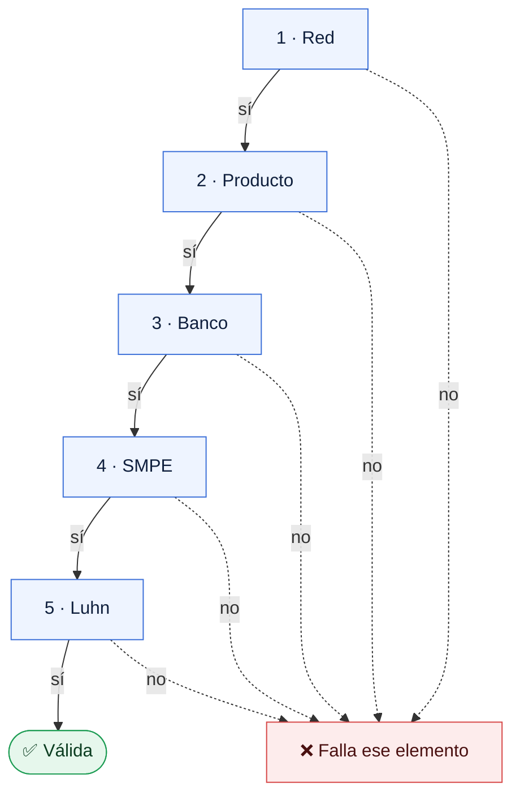

# Los elementos de una tarjeta y cómo validarlos uno a uno

Notas del fork de [@drlorente97](https://github.com/drlorente97) para ayudar a los formularios a decir **qué parte** de un número está mal. Es conocimiento de apoyo: no cambia ningún dato ni ninguna clave del catálogo.

El modelo completo con varias redes (`validators.networks`, patrones que exigen el SMPE, la Tropical solo en BANDEC y `explain()`) está en la rama `smpe-ais` de este fork. En el repositorio original queda como propuesta para diseñarla aparte.

## Los elementos

| Dígitos | Elemento | Ejemplo |
|:-:|---|---|
| 1–2 | **Red** | `92` |
| 3–4 | **Producto** | `05` |
| 5–6 | **Banco** | `06` |
| 7–9 | **SMPE** | `999` |
| 10–15 | Consecutivo | |
| 16 | Dígito de control Luhn (ISO/IEC 7812) | |

Cada elemento depende del anterior: el producto y el banco dependen de la red, y el SMPE depende del banco.

- **Red**: su código siempre empieza por 9.

  | Red | Código | Productos | Bancos |
  |---|:-:|---|---|
  | RED | `92` | Los del catálogo: CUP, USD con respaldo en MLC y la Tropical en USD | BANDEC, BPA, Metropolitano, BICSA |
  | AIS | `95` | `50` CUP, `60` USD | AIS |
  | Clásica | `97` | `60` USD | FINCIMEX |

- **Producto**: qué tarjeta es y en qué moneda. Un mismo código puede significar cosas distintas en cada red: `50` es USD con respaldo en MLC en RED, pero CUP en AIS. Red + producto es el prefijo que cataloga el repositorio (`9205`, `9550`…).
- **Banco**: quién emite la tarjeta. Cada banco pertenece a una sola red. La Tropical (`9240`) solo la emite BANDEC.
- **SMPE**: sufijo de la red interbancaria. No forma parte del código del banco, pero cada banco tiene siempre el mismo: BANDEC `999`, BPA `997`, Banco Metropolitano `987`, Clásica `900`. Sirve para confirmar el banco.

Un mismo producto puede tener dos usos. Por ejemplo, la `9227` es nómina (extensión del producto `24`) y también nómina de artistas, que según la ONAT es una cuenta bancaria fiscal.

## Validación en orden

Se valida un elemento cada vez y cada uno contra los anteriores. El primero que falla es el que hay que corregir.

| | Elemento | Es válido si… | Ejemplo que falla | Por qué |
|:-:|---|---|---|---|
| 1 | Red | es `92`, `95` o `97` | `93 …` | No es una red |
| 2 | Producto | existe en esa red | `95 05 …` | `05` es un producto de RED, no de AIS |
| 3 | Banco | es de esa red y, si el producto es exclusivo, de sus bancos | `92 05 03 …` `92 40 12 …` | `03` es de la Clásica La Tropical solo es de BANDEC |
| 4 | SMPE | es el de ese banco | `92 05 06 987 …` | `987` es el de Metropolitano |
| 5 | Luhn | el dígito de control cuadra | un dígito mal tecleado | |

Los patrones de `validators.json` hacen los pasos 1 a 4 de una vez. Para saber cuál falla hace falta comprobar cada elemento por separado.
